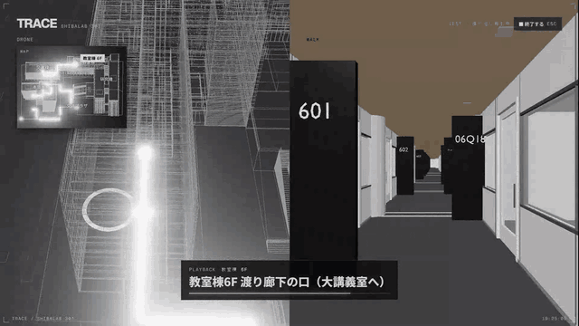
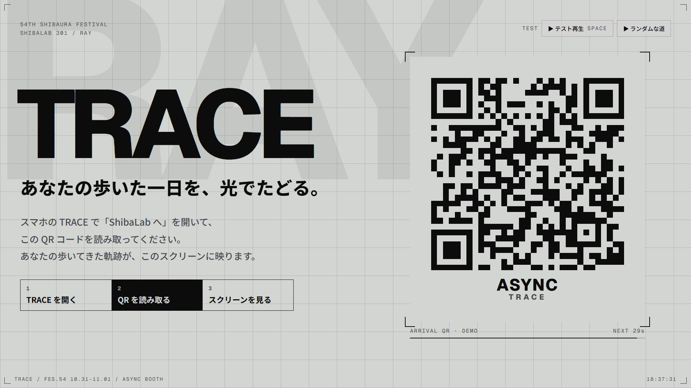
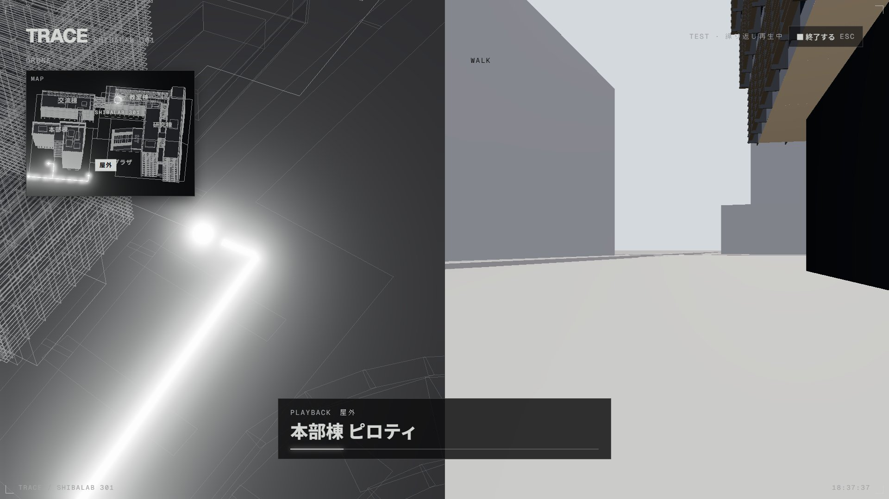
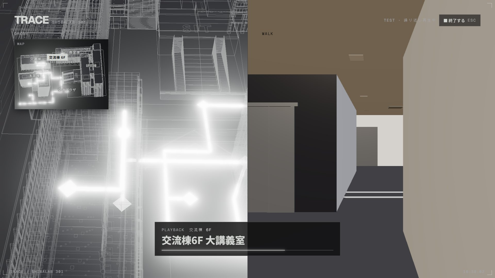
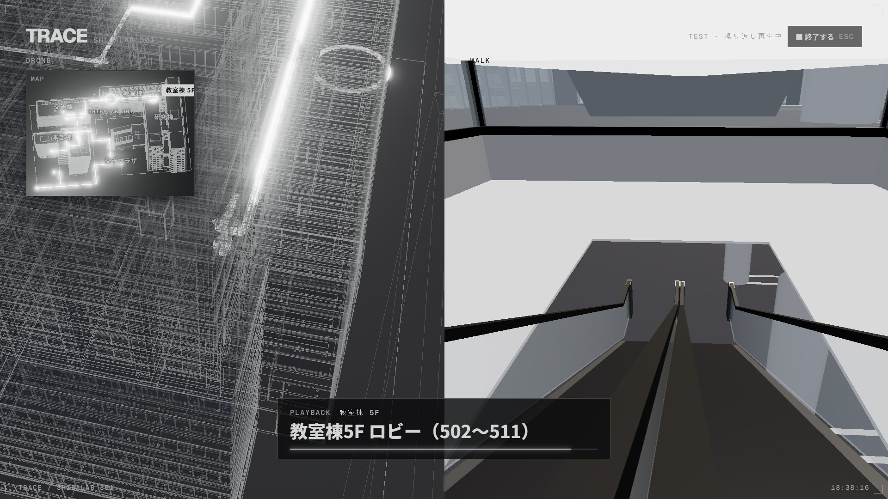
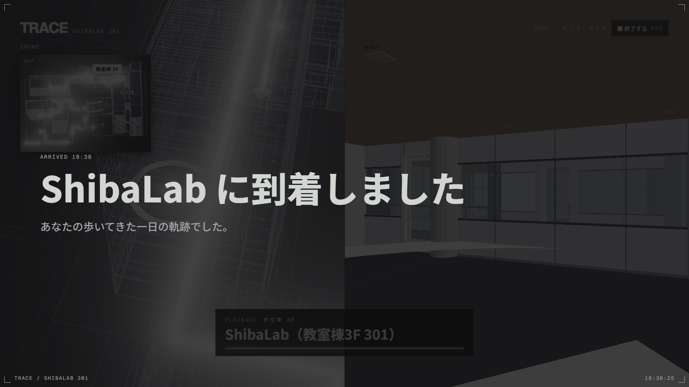

# 展示画面（/display）

ASYNC のブース（ShibaLab・教室棟301）のプロジェクターに出す画面です（#24）。
来場者が到着QR を読むと、その人が歩いてきた道を、キャンパスの 3D の上で光の線として再生します。
デザインは参加者の画面（/log、RAY）にそろえています。

## 動画



テスト再生の全体（トップ → 再生 → 到着 → 終了、2 倍速、約 50 秒）：[00_テスト再生.mp4](00_テスト再生.mp4)

## 画面

| トップ画面（到着QR） | 再生：外 |
|---|---|
|  |  |
| **再生：建物の中** | **再生：エスカレーター** |
|  |  |
| **到着** | |
|  | |

- **トップ画面**：到着QR（30秒ごとに切りかわる）と、読み取り方の案内
- **再生**：3つの画面
  - 左（大）：ドローン。光の先頭を斜め上から追いかける。建物は線画で、中を通る線も見える
  - 左上（小）：ミニマップ。キャンパス全体、建物の名前、ShibaLab の印、今いる建物と階
  - 右：一人称。建物を元の色で描き、その人の目の高さで歩く。エスカレーターでは、乗っているあいだの真ん中あたりで窓の外（大階段の花壇）のほうを向く
- **到着**：「ShibaLab に到着しました」を数秒出して、トップに戻る

## 試し方

```
npm run dev
```

http://localhost:3000/display を開き、右上の「▶ テスト再生」（スペースキー）か「▶ ランダムな道」で再生します。
テスト再生は「■ 終了する」（Esc）を押すまで、次の道を続けて流します。

| URL のパラメーター | 意味 |
|---|---|
| `?speed=1.5` | 歩く速さの倍率（標準：外 18m/秒、建物の中・渡り廊下 8m/秒、エスカレーター 4m/秒、階段 5m/秒） |
| `?duration=30` | 速さの割合はそのままで、1 本の道を 30 秒に収める |
| `?fps=1` | 1 秒に描けた回数を右下に出す（展示用の PC で確かめる用） |

e2e テスト：`TRACE_TEST_FRONTEND_URL=http://localhost:3000 npx playwright test tests/display.spec.ts`

## 音（#27）

| 場面 | 鳴る音 |
|---|---|
| トップ画面（到着QR） | 待っているときの BGM（ループ） |
| 再生が始まる | 到着QR を読めた音 → 再生中の BGM（ループ）へ |
| ShibaLab に着く | 再生中の BGM を 1 秒で消して、着いた音 |
| トップに戻る | 待っているときの BGM へ |

- 音のファイルは `public/display/sound/` に置く（ファイル名・形式・ループの決め方は、そのフォルダの README）。ないものは仮の音が鳴る
- ブラウザは一度クリックするまで音を出さないので、展示のはじめに「♪ 音を出す」を押す（テスト再生のボタンやスペースキーでも鳴りはじめる）
- BGM どうしは 1.5 秒のフェードでつなぐ

| URL のパラメーター | 意味 |
|---|---|
| `?volume=0.6` | 全体の音の大きさ（0〜1） |
| `?mute=1` | 音を出さない |
| `?sound=1` | 右下に、どの音が本物のファイルで、どれがまだ仮の音かを出す |

## しくみ

- 3D：`public/display/campus.glb`（`models/scripts/export_web.py` で Blender から書き出し。Draco 圧縮で約 1.4MB）
- 道の網：`models/trace/campus_graph.json` をそのまま読む（#8）
- 道の選び方（テスト用）：建物の中・渡り廊下・エスカレーターを通りやすく、外の道と階段を通りにくくして最短の道を探す（`src/lib/display/campus-graph.ts` の `INDOOR_FIRST`）
- three.js は `/display` を開いたときだけ読み込むので、参加者のスマホの画面は重くならない

## まだのこと

- 到着QR の中身は仮（`DEMO`）。本番では TRACE_B が出す、署名つきで期限のある到着トークンに替える（#10、TRACE_B #8）
- TRACE_B から WebSocket で到着イベント（通った点の id の列と `campusGraphVersion`）を受け取り、その人の道を再生する（TRACE_B #7・#9）。今のテストボタンの代わりに、届いたイベントで `play()` を呼ぶ
- 展示用の PC で、`?fps=1` を付けて速さを確かめる
