# 3DCG モデル（芝浦工業大学 豊洲キャンパス）

担当：渡部　／　Blender 5.2 で作成（2026-10-12 時点）

本部棟・交流棟・教室棟・研究棟の 4 棟と、敷地（地面・道路・運河・まわりの建物）を Blender で作りました。
**Unity・TouchDesigner では `export/` の FBX を使ってください。** Blender で続きを作るときは `.blend` を開きます。

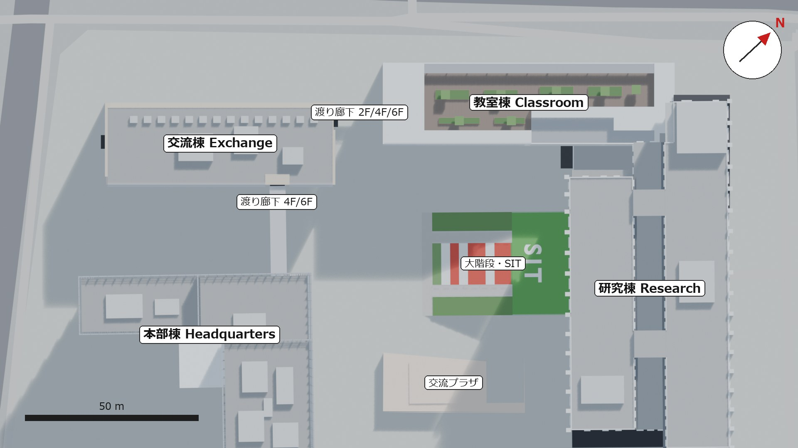

## 全体像

| | |
|---|---|
| 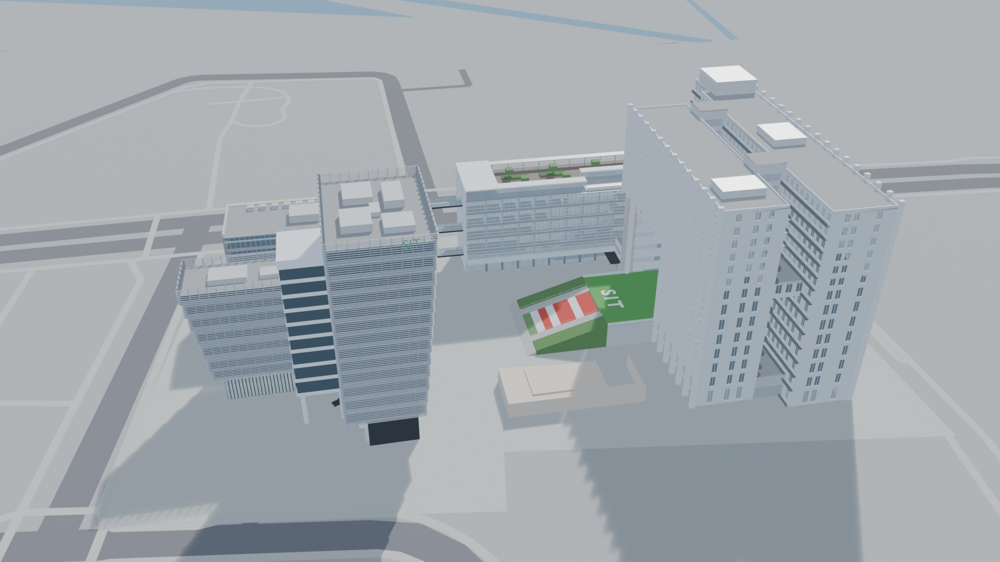 | 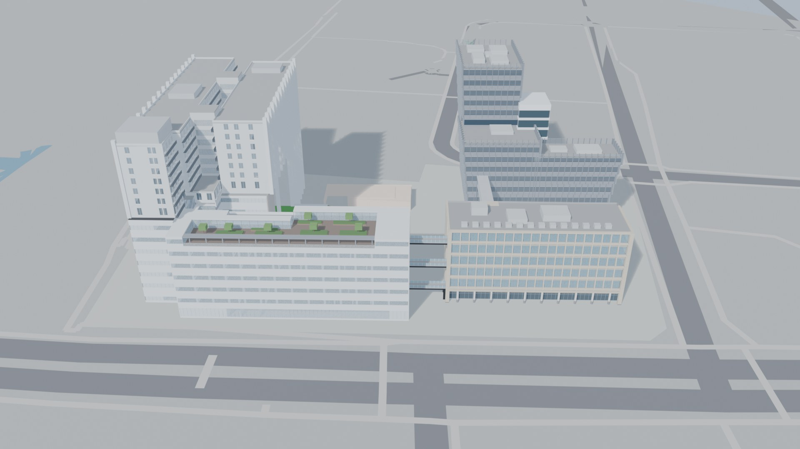 |
| 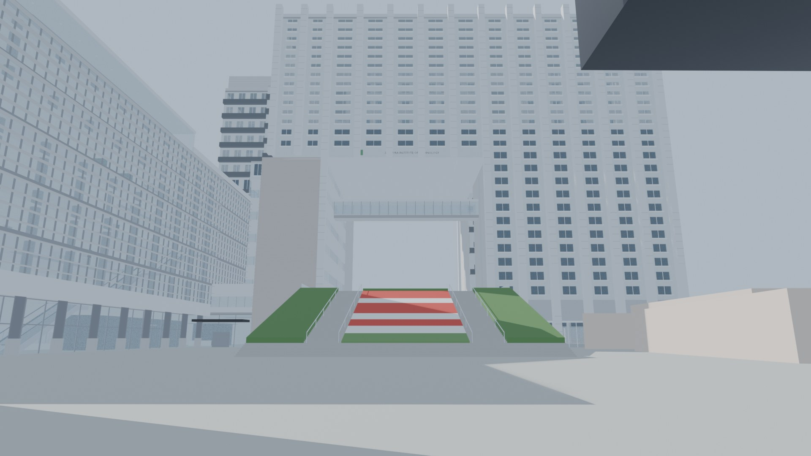 | 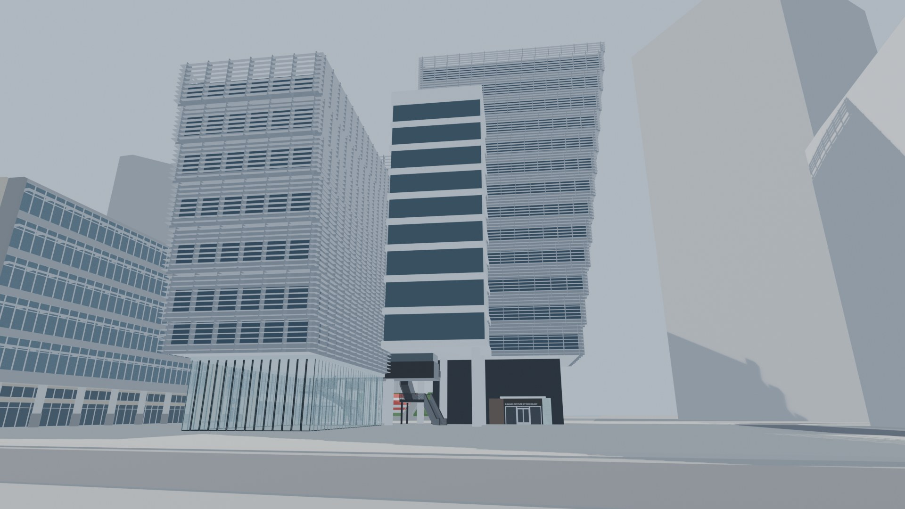 |
| 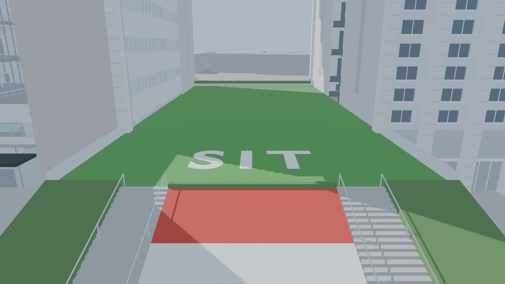 | 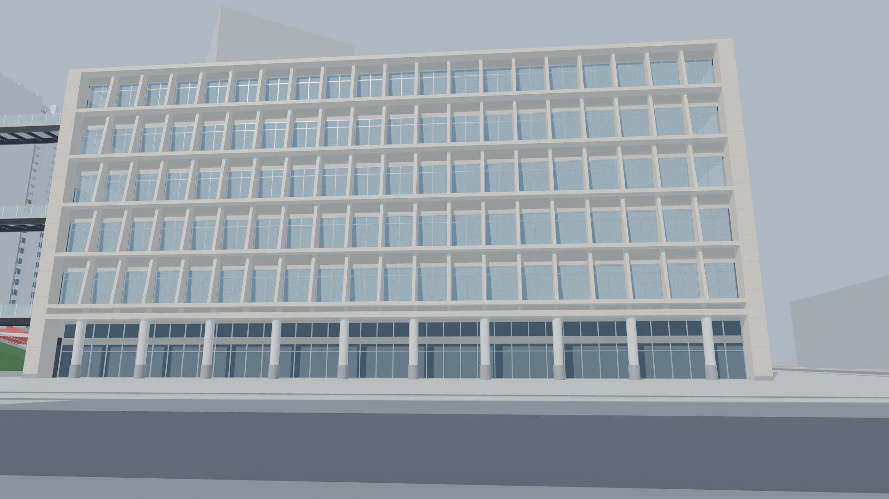 |
| 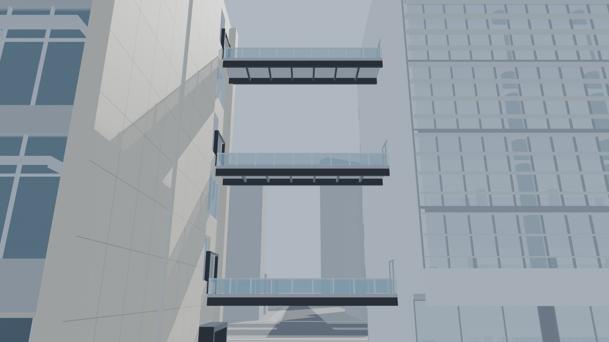 | 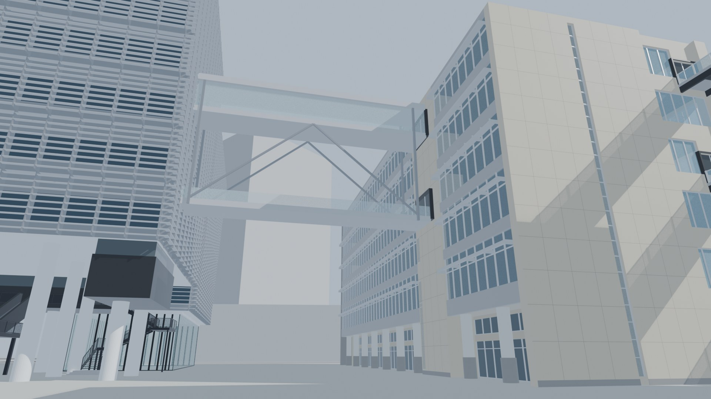 |
| 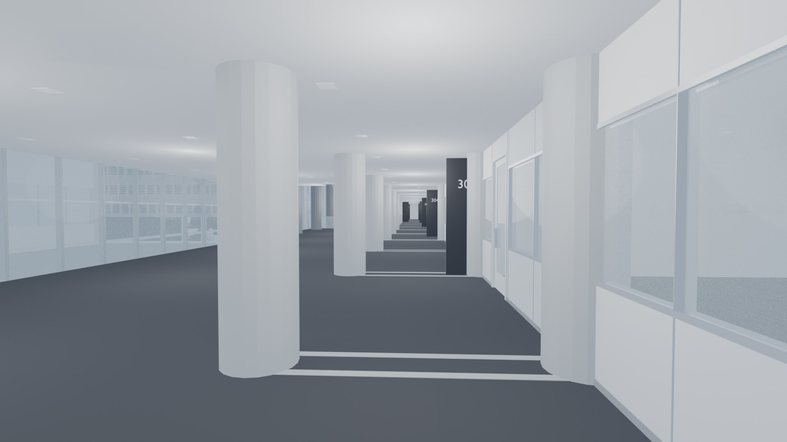 | 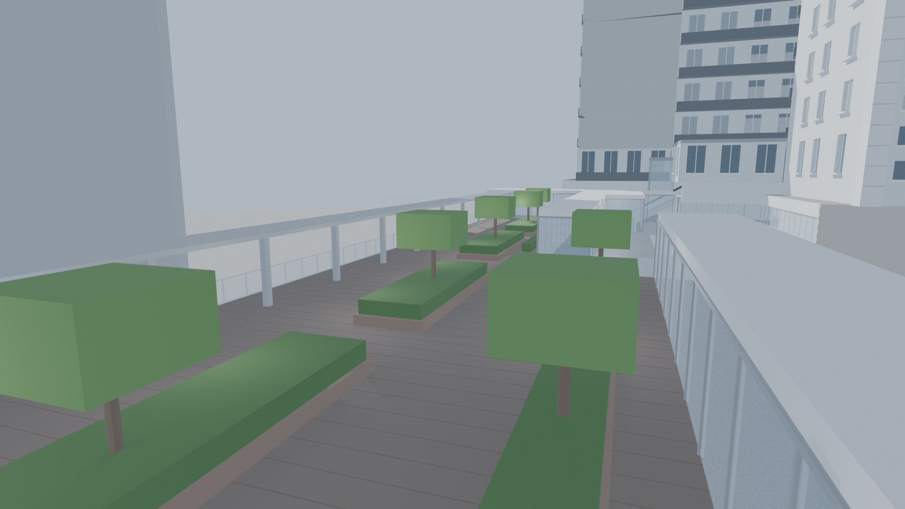 |
| 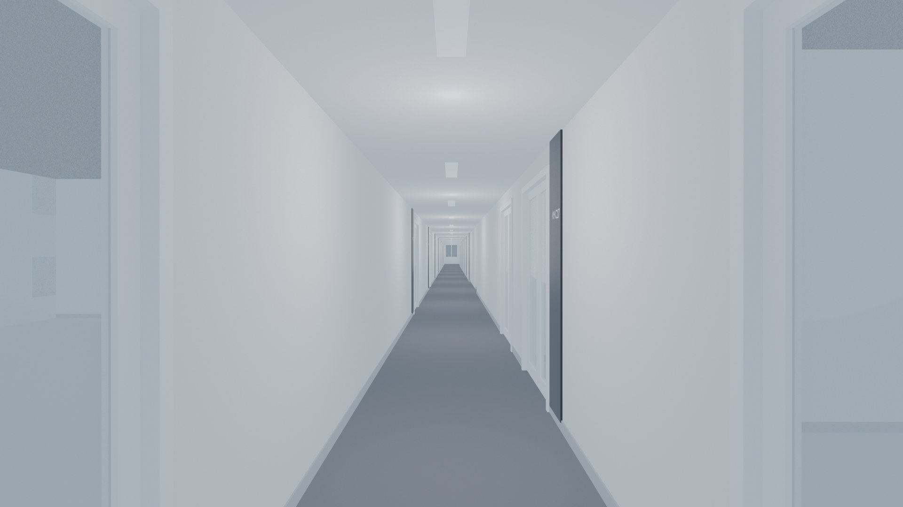 | 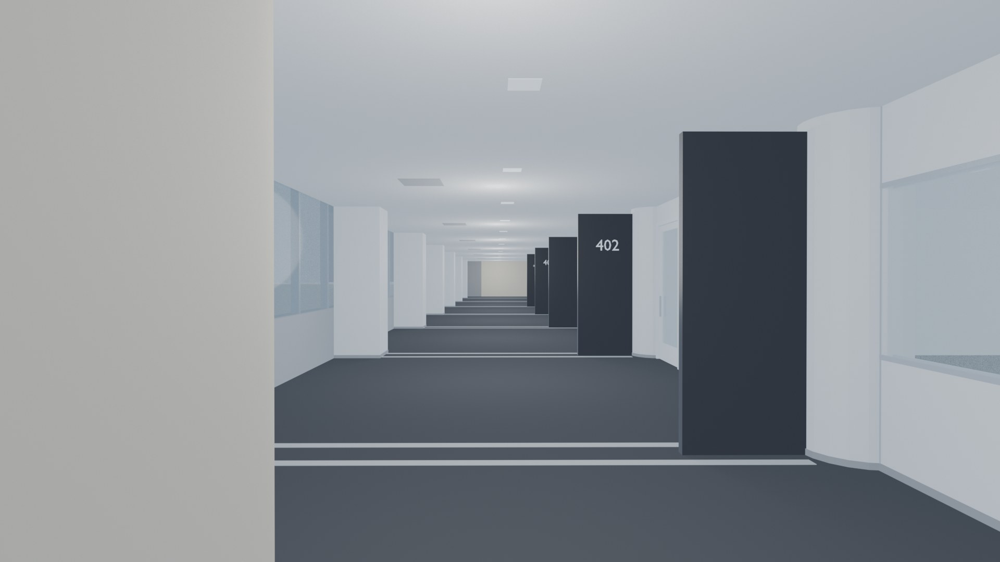 |

## フォルダ

```
models/
├─ export/                 ← Unity・TouchDesigner 用（FBX）
├─ キャンパス全体.blend      ← 全部入り（下の建物ファイルと site.blend をリンクで並べたもの）
├─ site.blend              ← 敷地：地面・道路・運河・まわりの建物・交流プラザ
├─ buildings/
│   ├─ 研究棟.blend / 教室棟.blend / 交流棟.blend / 本部棟.blend
│   └─ 配置.json            ← 各建物の地図上の位置と向き
├─ scripts/                ← モデルを作り直す Blender のスクリプト
├─ renders/                ← 上の画像
└─ trace/                  ← TRACE のチェックポイント（campus_graph.json）。説明は trace/README.md
```

## export/（FBX）

| ファイル | 中身 | 頂点数 |
|---|---|---|
| `campus_all.fbx` | 敷地＋4 棟の外観と内装（全部） | 約 25 万 |
| `campus_exterior.fbx` | 敷地＋4 棟の外観だけ（軽い） | 約 17 万 |
| `research_exterior.fbx` / `research_interior.fbx` | 研究棟 | 4.2 万 / 4.7 万 |
| `classroom_interior.fbx` | 教室棟（外観はまだなので、内装に仮の外壁が入っている） | 7.6 万 |
| `exchange_exterior.fbx` / `exchange_interior.fbx` | 交流棟 | 1.5 万 / 1.1 万 |
| `headquarters_exterior.fbx` / `headquarters_interior.fbx` | 本部棟 | 2.4 万 / 3.0 万 |

- 単位はメートル、**Y が上**。Unity・TouchDesigner に読み込むと、そのまま 1 = 1m
- 原点
  - 建物ごとのファイル：その建物の足元の中心（地面）
  - `campus_*.fbx`：4 棟の真ん中あたりの地面（`export_info.json` の `campus_origin_map_xy`）。建物は地図どおりの位置に並んでいる
  - 外観と内装は同じ原点なので、同じ位置に置けば重なる
- マテリアルは色だけ（テクスチャなし）。窓などは面を分けて色で表している
- オブジェクトの名前は日本語（例：`研究棟_外観`、`交流棟_渡り廊下（教室棟へ）`）

### Unity
`export/` の FBX を Assets にドラッグ → シーンに置くだけ。スケールは 1 のままで OK。

### TouchDesigner
FBX COMP の「Import File」で FBX を読み込む。

## できていること・まだのこと

| 建物 | 外観 | 内装 |
|---|---|---|
| 本部棟 | ○（ルーバー・ピロティ・階段・エスカレーター） | 3〜14F（フロア案内図から） |
| 交流棟 | ○ | 4〜6F |
| 教室棟 | 南東面だけ写真から（ほかは仮の壁） | 1〜7F（吹き抜け・エスカレーター・7F 空中庭園） |
| 研究棟 | ○（ゲート・大階段・SIT の芝生・光庭） | 1F・9〜14F（2〜8F は外観だけ。8F の図書館は重くなるので作らない） |

- 渡り廊下：教室棟〜交流棟（2F・4F・6F）、本部棟〜交流棟（4F・6F）、教室棟〜研究棟（6F）
- 階の高さは全部の建物で教室棟にそろえている（1F 0m・2F 6m・3F 11m・4F 16m・5F 21m・6F 26m）
- 寸法は写真・案内図・航空写真・PLATEAU から推定したもので、実測ではない（雰囲気優先）

## Blender で開くとき
- `キャンパス全体.blend` は建物ファイルを**リンク**しているので、フォルダの形を変えずに開く。建物の編集はそれぞれの建物ファイルで行い、保存してから `キャンパス全体.blend` を開き直すと反映される
- 参考用の画像（大学の写真、航空写真、PLATEAU のテクスチャ）は著作権の都合で入れていない。`site.blend` の参考用のコレクション（航空写真・PLATEAU 参考）はピンク色になるが、モデルには関係ない
- 作り直し（Blender 5.2）
  - 建物：`blender -b buildings/研究棟.blend --python scripts/build_kenkyuto.py -- --save` など（各スクリプトの先頭に書いてある）
  - FBX：`blender -b --factory-startup --python scripts/export_all.py`
  - キャンパス全体：`blender -b --factory-startup --python scripts/make_campus_all.py`
  - 画像：`blender -b キャンパス全体.blend --python scripts/render_showcase.py -- renders_tmp` → `python scripts/label_plan.py renders_tmp`
