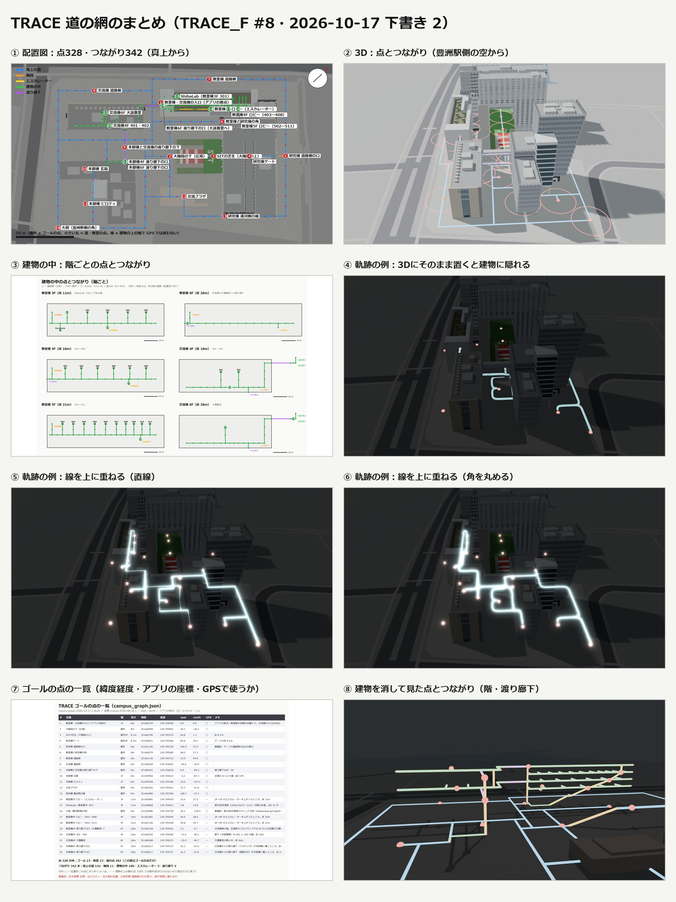

# TRACE の道の網（CampusGraph）

担当：渡部　／　2026-10-17 下書き 2（#8）

来場者の位置をキャンパスの道の上に乗せて、光の線でたどるためのデータです。
歩ける道に **数m〜10m おきに点** を打ち、京都の町の道のように **まっすぐな線と曲がり角だけ** でつないでいます（PR #20 のコメント）。
**バックエンドで使うのは `campus_graph.json` だけです。**



## campus_graph.json

- 点 328 か所・つながり 342 本。`campusGraphVersion` は `toyosu-graph-2026-10-17.2.draft`
- 点の種類（`role`）

| role | 数 | 中身 |
|---|---|---|
| `checkpoint` | 23 | ゴール・目印の点（名前がある。例：`classroom-entrance`、`shibalab`）。前の版の点と同じ id |
| `room` | 23 | 教室の中の点（例：教室棟3F 302） |
| `waypoint` | 282 | 道の途中の点。外は 10m おき、建物の中は 6m おき。id は `o-001`（外）・`k3-001`（教室棟3F）・`x4-001`（交流棟4F）・`h1-001`（本部棟1F）など |

- 点（`nodes`）の項目

| 項目 | 中身 |
|---|---|
| `id` / `name` / `role` | 上の表 |
| `building` / `floor` | 建物と階（屋外は `null` / `屋外`） |
| `lat` / `lon` | 緯度経度（WGS84） |
| `local.east` / `local.north` | アプリのローカル座標（m）。原点 = 教室棟1F南面の自動ドア。`coordinateVersion` = `toyosu-2026-08-28.1` の式で緯度経度から計算 |
| `heightMetres` | 地面からの高さ。MVP は高さ固定なので経路の計算には使わない（演出用） |
| `threeD` | 3DCG（`キャンパス全体.blend`）の座標。1 = 1m、Z が上 |
| `radiusMetres` | この点にまとめる範囲の目安（ゴール 15m、外の道 5m、建物の中 3m） |
| `gpsSnap` | `true` = 地面の高さの外の点（GPS の位置を乗せてよい）。`false` = 建物の中の点。GPS では階や部屋を見分けられないので演出だけに使う |

- つながり（`edges`）：`from` / `to` / `kind`（`ground` 地上の道・`stairs` 階段・`escalator` エスカレーター・`indoor` 建物の中・`bridge` 渡り廊下）/ `lengthMetres`（平面の直線距離）/ `passable`
- 入口（`classroom-entrance`）からすべての点にたどれる（離れ小島の点はない）

## 決めたこと
- ゴールの点（23 か所）はそのまま残し、道の線がそこを通るようにした
- 道は「碁盤の目」の向き（教室棟の長い辺の向きと、それに直角）だけで引いた。教室棟・交流棟・本部棟はこの向きにそろっていて、研究棟は 90° 回っているので、そのままカクカクの道になる
- 建物の中は**第54回芝浦祭（2026/10/31〜11/1）の会場の階**だけ（[芝浦祭のフロアマップ](https://shibaurasai.jp/map54/)）。研究棟の中は作らない
  - 教室棟：3F（ShibaLab は **301**）、4F（403〜408）、5F（502〜511）、6F（交流棟の大講義室への渡り廊下）。廊下に 6m おき、教室ごとに 1 点
  - 交流棟：4F（401・402）、6F（大講義室）
  - 本部棟：会場はないが、交流棟と渡り廊下でつながる 4F・6F と、そこから 1F の玄関へ下りる階段
  - 階どうしはエスカレーター・階段、建物どうしは渡り廊下（教室棟〜交流棟は 4F・6F、交流棟〜本部棟は 4F・6F）
- 3DCG の座標は PLATEAU と同じ平面直角座標系 第IX系なので、そのまま緯度経度に直せる。アプリの原点を 3DCG に置くと、教室棟の壁から 0.45m 以内に乗る（アプリと 3DCG の座標はずれていない）
- ⑯ 大樹（豊洲駅側の角）は、芝浦祭のキャンパス図で豊洲駅から来る入口になっているので足した

## まだ決まっていないこと
- 位置の確認：⑩ 本部棟 玄関・⑪ ピロティ・⑯ 大樹（推定）、⑤ 研究棟 道路側の口の高さ、道が実際に通れるか
- #8 のコメントにある、node/edge ID の決まり・通行止め・版の組み合わせ（`coordinateVersion` / `campusGraphVersion` / `threeDMapVersion`）

## 軌跡の見せ方（試した結果）
- 線を 3D の中にそのまま置くと、建物の中・下で隠れて、ほとんど見えない（`figures/04`）
- 建物と線を別々にレンダーして、線をグローつきで上に重ねると、カクカクの道すじがはっきり見える（`figures/05`・`06`）。TouchDesigner でも同じようにレイヤーを重ねる想定
- 建物を消すと、階の重なりと渡り廊下が見える（`figures/08`）

## ファイル

```
trace/
├─ campus_graph.json        ← バックエンドに渡すもの（export() で書き出す）
├─ campus_graph.src.json    ← 元データ（点の位置 = 3DCG の座標）
├─ build_network.py         ← 道の定義から点とつながりを作る（元データを作り直す）
├─ trace_graph.py           ← Blender に置く（build）・書き戻す（pull）・書き出す（export）
├─ render_graph_plan.py / label_graph_plan.py   ← 配置図（figures/01）
├─ render_figures.py / glow_composite.py         ← 3D の図と軌跡の例（figures/02・04〜06・08）
├─ fig_3F_and_table.py / fig_summary.py          ← 建物の中の階ごとの図・一覧表・まとめ（figures/03・07・00）
└─ figures/
```

座標の変換は `../scripts/trace_geo.py`（第IX系 ↔ 緯度経度 ↔ アプリのローカル座標）。

## 道を直すとき
- **道を足す・消す**：`build_network.py` の `path(...)` を直して `python trace/build_network.py` → Blender で `build()` → `export()`
- **点を少し動かす**（Blender 5.2）
  1. `キャンパス全体.blend` を開く。道の網は コレクション `30_TRACE_チェックポイント` の 1 つのメッシュ `TRACE_道の網`（頂点 = 点、辺 = つながり。見た目は Geometry Nodes）
  2. 編集モードで頂点を動かす（**頂点を足したり消したりしない**。頂点の番号が点の id とずれる）
  3. Python コンソールで `exec(open(r"<models のパス>/trace/trace_graph.py", encoding="utf-8").read())` → `pull()` → `export()`
  - `build_network.py` で作り直すと、`pull()` で動かした分は消える（ゴールの点の位置だけは残る）
- `scripts/make_campus_all.py` の最後でも `build()` するので、作り直しても道の網は消えない
- 図はレンダーしたあと PNG を JPG にして入れている
